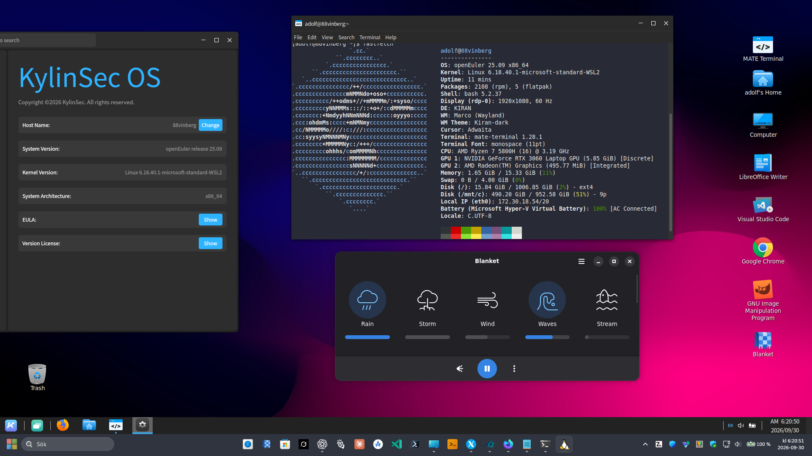

# OpenEuler - Desktop test FOR WSL - 2026

<p align="center">
<a href="https://github.com/vinberg88">

</p>

---

# About OpenEuler OS for WSL - OpenEuler is fun to USE!

<p align="center">
OpenAtom openEuler (openEuler for short) is an open source project incubated and operated by the OpenAtom Foundation. openEuler is an open source OS oriented to
digital infrastructure that fits into any server, cloud computing, edge computing, and embedded deployment. This secure, stable, and easy-to-use open source OS 
is compatible with multiple computing architectures. openEuler suits operational technology (OT) applications and empowers the convergence of OT and information
and communications technology (ICT). The openEuler community works with global developers to build an open, diversified, and architecture-inclusive software 
ecosystem. It covers all scenarios of digital facilities, and empowers enterprises to develop their hardware and software as well as application ecosystems.
OpenEuler works perfect and it fun to use for diffrent desktops via WSL.
</p>

---


A community collection for running complete openEuler desktop environments in WSL 2 on Windows.

The first tested desktop is **Kiran Desktop on openEuler 25.09 through X410**. The repository is structured so UKUI, GNOME, KDE Plasma, XFCE, Deepin and other desktops can be added without mixing their launchers, settings or diagnostics.

> This is a Community project. Official openEuler, KylinSec, Microsoft or X410 project.

---

# OpenEuler 25.09 and XFCE4 For WSL - 2026

Comming SONE working on this NOW...

Have to install all - Video via YouTUBE - TEXT via GitHUB

Text Via GITHUB - [How to install XFCE4 desktop via OpenEuler 25.09](OpenEuler25.09-XFCE4.txt)

Video via YouTUBE - Comming SONE [HOW TO INSTALL XFCE4 desktop via OpenEuler 25.09](https://www.youtube.com/watch?v=mdPZTSXXc4w)

<p align="center">
<a href="https://github.com/vinberg88/openEuler/blob/main/OpenEuler25.09-XFCE4.txt">

</p>

About xfce4 for Linux - 2026 - https://www.xfce.org

Xfce or XFCE4 (pronounced as four individual letters) is a free and open-source desktop environment for Linux and
other Unix-like operating systems. Linux, FreeBSD, NetBSD, OpenBSD and GNU/Hurd. Xfce aims to be fast and lightweight
while still being visually appealing and easy to use.

---

# OpenEuler 23.09 and UKUI desktop For WSL - 2026

Text Via GITHUB - [How to install UKUI desktop via OpenEuler 23.09](https://github.com/vinberg88/openEuler/blob/main/openEuler-23.09-UKUI.txt)

Video via YouTUBE - Comming SONE [HOW TO INSTALL UKUI desktop via OpenEuler 23.09](https://www.youtube.com/watch?v=mdPZTSXXc4w)

[About OpenEuler for WSL and Windows 11](https://www.openeuler.org/en/)

In addition, openEuler community is an open-source community for global OSs. Through community cooperation, openEuler
builds an innovative platform, builds a unified and open OS that supports multiple processor architectures, and promotes
the prosperity of the software and hardware application ecosystem.

<p align="center">
<a href="https://github.com/vinberg88">

</p>

[About UKUI for OpenEuler](https://docs.openeuler.org/en/docs/24.03_LTS_SP3/tools/desktop/ukui/ukui_user_guide.html)

UKUI is a Linux desktop built by the KylinSoft software team over the years, primarily based on GTK and QT. 
Compared with other UIs, UKUI is easy to use. The Components of UKUI are lightweight and can run independently without
relying on other suites. It can provide user a friendly and efficient experience. UKUI supports both
x86_64 and aarch64 architectures.

---

# OpenEuler 26.09 and Kiran desktop - 2026

Text Via GITHUB - [How to install KIRAN](https://github.com/vinberg88/openEuler/blob/main/OpenEuler26.09-KIRAN.txt)

Video VIA YouTUBE - KIRAN - [WATCH NOW HOW TO INSTALL](https://www.youtube.com/watch?v=mdPZTSXXc4w)

[About openEuler 26.09](https://docs.openeuler.org/en/docs/26.09/server/index.html)

OpenEuler is an open source project incubated andoperated by the OpenAtom Foundation. EulerOS is a
commercial Linux distribution developed by Huawei based on Red Hat Enterprise Linux.

<p align="center">
<a href="https://github.com/vinberg88/openEuler/releases">

</p>

---

[About KIRAN](https://docs.openeuler.org/en/docs/22.03_LTS_SP3/docs/desktop/Kiran_userguide.html)

Kylinsec OS is a high-security, highly reliable Linux-based
operating system developed by Hunan Kylin Information Security
Technology Co., Ltd. (Kylinsec), designed for critical
infrastructure, government, and enterprise environments.

---

# KDE 5 and openEuler 25.09 - WSL - 2026

Working on that right now.. Comming project for openEuler  25.09 

About OpenEuler 25.09 - https://www.openeuler.org/en

OpenEuler is an open source project incubated and operated
by the OpenAtom Foundation. EulerOS is a commercial Linux
distribution developed by Huawei based on Red Hat
Enterprise Linux. To provide an operating system for
server and cloud environments. Its open-source Community
version is known as openEuler, of which source code was
released by Huawei at Gitee on December 31, 2019. OpenEuler
became an open-source project operated by OpenAtom
Foundation after Huawei donated the source code of
openEuler to the foundation on November.  

<p align="center">
<a href="https://github.com/vinberg88">

</p>

What is KDE - Desktop - https://kde.org

Use Plasma to surf the web; keep in touch with colleagues, 
friends and family; manage your files, enjoy music and
videos; and get creative and productive at work. Do it all
in a beautiful Environment that adapts to your needs,
and with the safety, privacy-protection and peace of mind
that the best Free Open Source Software has to offer. KDE
Plasma is a Desktop for next life =)

---

# WSL - OpenEuler 25.09 via GNOME Desktop

How to install GNOME deskop on openEuler 25.09

<p align="center">
<a href="https://github.com/vinberg88/openEuler/blob/main/OpenEuler25.09-GNOME.txt">

</p>

- **GitHUB Text Guide:** [Install GNOME desktop via openEuler](OpenEuler25.09-GNOME.txt)

- **YouTube video guide:** [How to install GNOME via openEuler](https://www.youtube.com/watch?v=9MUJaIaQZ9I)

About Gnome desktop - https://www.gnome.org

Every part of GNOME has been designed to make it simple
and easy to use. The Activities Overview is a simple
way to access all your basic tasks. A press of a button
is all it takes to view your open windows, launch
applications, or check if you have new messages. Having
everything in one convenient place means you don’t have
to learn your way around a maze of different technologies. 
GNOME provides a focused working environment that helps
you get things done.

---

# WSL - OpenEuler via Kiran Desktop - 25.09



## Installation walkthrough and video

- GitHUB Text Guide: [Complete Kiran installation walkthrough](OpenEuler25.09-KIRAN.txt)

- **YouTube video guide:** [How to install KIRAN via openEuler](https://www.youtube.com/watch?v=2XqTazXq5JY)

The supported quick installer below is the shortest route. The longer walkthrough also covers the openEuler setup, optional desktop applications and the final X410 startup steps.

## Quick install: Kiran + X410

Run this inside the openEuler WSL distribution as your normal Linux user, not as root:

```bash
wget https://raw.githubusercontent.com/vinberg88/openEuler/main/install.sh
less install.sh
bash install.sh kiran
```

The installer downloads the Kiran launcher files, installs the complete openEuler `kiran-desktop` package when needed, validates the environment, installs the Linux service and creates a **Kiran Desktop (X410)** shortcut on the Windows desktop.

Every downloaded launcher file is checked against a SHA-256 digest embedded in the reviewed installer before it can be executed or installed.

Keep download and execution as separate steps. Do not pipe a remote installer directly into a shell; downloading it first makes the exact code being granted installation privileges visible and reviewable.

## Requirements

- Windows 11 with WSL 2
- openEuler 25.09
- systemd enabled in `/etc/wsl.conf`
- openEuler repositories providing the `kiran-desktop` package
- X410 installed on Windows and available through its app execution alias
- `sudo`, `wget` or `curl`

## Commands after installation

```bash
kiran-x410 start
kiran-x410 stop
kiran-x410 restart
kiran-x410 status
kiran-x410 doctor
kiran-x410 log
```
---

<p align="center">
<a href="https://github.com/vinberg88">

</p>

---
## Normal start

1. Double-click **Kiran Desktop (X410)** on the Windows desktop.
2. Wait a few seconds while the shortcut starts X410 in Desktop mode and launches the managed Kiran session.
3. Leave X410 running quietly in the Windows background or system tray for the entire Kiran session.

X410 is the display server behind the desktop. It should not need a separate visible control window, but it must remain running while Kiran is in use. Do not start `kiran-session-manager` manually alongside the shortcut, because that can create duplicate panels and unpredictable sessions.

## Uninstall the integration

Download and inspect the uninstaller, then run it as the same normal Linux user:

```bash
wget https://raw.githubusercontent.com/vinberg88/openEuler/main/uninstall.sh
less uninstall.sh
bash uninstall.sh kiran
```

This removes the launcher, user service and Windows shortcut. It deliberately keeps the openEuler `kiran-desktop` packages, personal files and session logs.

## Desktop collection

| Desktop | openEuler version | Display path | Status |
|---|---:|---|---|
| Kiran Desktop | 25.09 | X410 / X11 | ✅ Tested |
| UKUI | To be selected | X410 / X11 | 🧪 Planned |
| GNOME | 25.09 | WSLg or X410 | ✅ Tested |
| KDE Plasma | To be selected | X410 / X11 | 🧪 Planned |
| XFCE | To be selected | X410 / X11 | 🧪 Planned |
| Deepin Desktop | To be selected | X410 / X11 | 🧪 Planned |
| Cinnamon | To be selected | X410 / X11 | 🧪 Planned |
| MATE | To be selected | X410 / X11 | 🧪 Planned |
| LXQt | To be selected | X410 / X11 | 🧪 Planned |

See [DESKTOPS.md](DESKTOPS.md) for the test standard and roadmap.

## What the Kiran installer fixes

- always runs Kiran as the selected non-root Linux user;
- discovers the Windows host address instead of reusing WSLg's `DISPLAY`;
- starts one controlled X11 session with Marco, Kiran Panel and Caja;
- keeps WSL alive through a hidden Windows-side holder process;
- preserves WSLg audio when its Pulse server is available;
- prevents duplicate session launches with a runtime lock;
- disables WSL-inappropriate network, printer, SELinux and lock-screen applets for the current user;
- writes a readable session log under `~/.local/state/kiran-x410/`.

---

<p align="center">
<a href="https://github.com/vinberg88">

</p>

---

## Repository layout

```text
.
├── LICENSE
├── OpenEuler25.09-KIRAN.txt
├── install.sh
├── uninstall.sh
├── DESKTOPS.md
├── desktops/
│   └── kiran/
│       ├── README.md
│       └── files/
└── images/
```

Each future desktop receives its own installer assets and documentation under `desktops/<name>/`.

## Troubleshooting

### `powershell.exe: Permission denied`

If the installer reaches the Windows shortcut step and reports that `powershell.exe` is not permitted, check `/etc/wsl.conf`. An automount option such as `fmask=11` removes the execute bit from Windows programs for normal Linux users. Change that option to:

```ini
[automount]
enabled=true
root=/mnt/
options="metadata,umask=22,fmask=022"
```

Then close WSL and run this from **Windows PowerShell**:

```powershell
wsl --shutdown
```

Start openEuler again and rerun `bash install.sh kiran`. The installer is repeatable, so the partially completed first run does not need to be removed.

Run:

```bash
kiran-x410 doctor
kiran-x410 log 200
```

Do not start `kiran-session-manager`, `kiran-panel` or the desktop with `sudo`. Mixing root sessions, WSLg's display and X410 is the main cause of duplicated panels and unpredictable startup.

<p align="center">
<a href="https://github.com/vinberg88">

</p>

---

## OpenEuler for WSL and Desktops - 2026 - Have fun and play - OpenEuler

<p align="center">
openEuler is a Linux distribution with a focus on the enterprise segment along with servers, cloud and edge. Originally developed by Huawei,
it is now developed and governed by the Open Atom Foundation. It is the first open source software foundation in China and is backed
by big names like Huawei, Alibaba, Tencent, Baidu etc. China's Ministry of IT is also part of the foundation.
</p>

<p align="center">
This project runs via Mattias Vinberg - Stockholm - Sweden 2026 - Find More WSL stuff here - https://github.com/vinberg88
</p>


